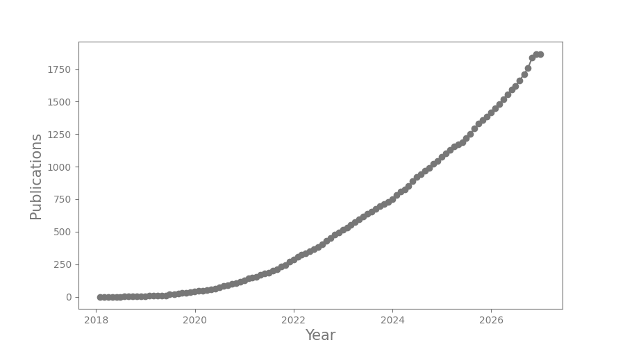

<h1>Lightkurve statistics</h1>

  

|    | Date       | Title                                                                                                                                                                                     | Author     |
|---:|:-----------|:------------------------------------------------------------------------------------------------------------------------------------------------------------------------------------------|:-----------|
|  0 | 2027-01-01 | [Detection of quasi-periodic pulsations in solar flares based on a ResNet-Transformer hybrid model](https://ui.adsabs.harvard.edu/abs/2027A&C....5801193H/abstract)                       | Hu, W      |
|  1 | 2026-12-01 | [GSC 08227-00723: An AH Pic-type System with an Unusually Large Positive Superhump Excess—Implications for Tidal Effects](https://ui.adsabs.harvard.edu/abs/2026RAA....26l5012L/abstract) | Li, X      |
|  2 | 2026-11-01 | [TIC 197757000: An Eclipsing Binary System Containing a δ Scuti-type Pulsating Star with Tidal Synchronization](https://ui.adsabs.harvard.edu/abs/2026RAA....26k5001Y/abstract)           | Yaqup, S   |
|  4 | 2026-11-01 | [Assessing the Impact of High-resolution Imaging on Statistical Validation of TESS Planet Candidates](https://ui.adsabs.harvard.edu/abs/2026AJ....172..247C/abstract)                     | Collier, M |
|  5 | 2026-11-01 | [The Discovery of K2-232c: Divergent Formation Histories for Hot and Warm Jupiters Based on Outer Companion Eccentricity](https://ui.adsabs.harvard.edu/abs/2026AJ....172..254R/abstract) | Ranshaw, J |
    