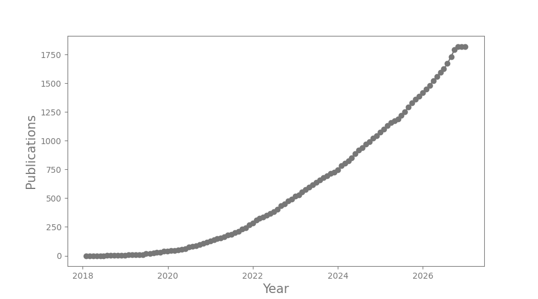

<h1>Lightkurve statistics</h1>

  

|    | Date       | Title                                                                                                                                                                                                                           | Author       |
|---:|:-----------|:--------------------------------------------------------------------------------------------------------------------------------------------------------------------------------------------------------------------------------|:-------------|
|  0 | 2027-01-01 | [Detection of quasi-periodic pulsations in solar flares based on a ResNet-Transformer hybrid model](https://ui.adsabs.harvard.edu/abs/2027A&C....5801193H/abstract)                                                             | Hu, W        |
|  1 | 2026-12-01 | [GSC 08227-00723: An AH Pic-type System with an Unusually Large Positive Superhump Excess—Implications for Tidal Effects](https://ui.adsabs.harvard.edu/abs/2026RAA....26l5012L/abstract)                                       | Li, X        |
|  2 | 2026-11-01 | [TIC 197757000: An Eclipsing Binary System Containing a δ Scuti-type Pulsating Star with Tidal Synchronization](https://ui.adsabs.harvard.edu/abs/2026RAA....26k5001Y/abstract)                                                 | Yaqup, S     |
| 16 | 2026-10-01 | [A Novel Approach to Identify Unseen Companions: An In-Depth study of GDR3 220_28](https://ui.adsabs.harvard.edu/abs/2026arXiv261009630C/abstract)                                                                              | Cysil, T     |
| 28 | 2026-10-01 | [Constraints on Late-time Flaring from Luminous Fast Blue Optical Transients Using the Transiting Exoplanet Survey Satellite and the Zwicky Transient Facility](https://ui.adsabs.harvard.edu/abs/2026ApJ..1009..171J/abstract) | Jayaraman, R |
    